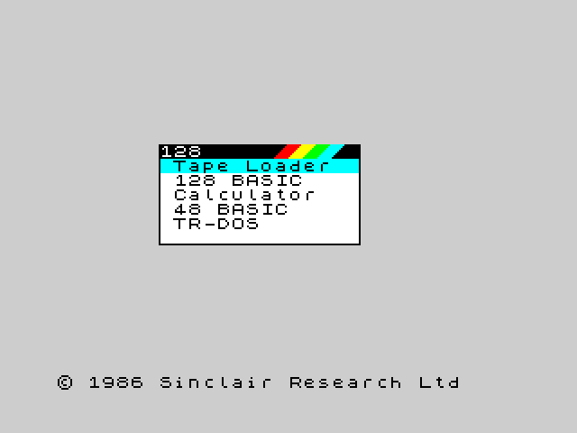

# ZX Spectrum emulator in PHP

A ZX Spectrum 48K / 128K / Pentagon emulator written in plain PHP, with no extensions or Composer packages. It runs in the terminal and shows the real picture through the Kitty or iTerm2 graphics protocol, with beeper and AY sound through `ffplay`. It loads snapshots, tapes and TR-DOS disks.



## Features

- **Z80 CPU.** All documented and undocumented instructions are implemented, including IXH/IXL, SLL, `OUT (C),0` and DDCB register copies. The core passes all 67 ZEXDOC tests.
- **Machines:**
  - Spectrum 48K.
  - Pentagon 128: 128K RAM with port 7FFD paging, the AY-3-8912 sound chip and Pentagon frame timing.
- **Video.** The picture is drawn beam-accurately, in 8-pixel cells timed to the T-state, so multicolour and border effects work.
- **Sound:**
  - Beeper.
  - AY-3-8912 with ABC stereo. Tone, noise and envelope generators follow [ayumi](https://github.com/true-grue/ayumi).
- **Snapshots.** `.sna` (48K and 128K) and `.z80` (v1, v2 and v3).
- **Tapes.** `.tap` and `.tzx`:
  - Standard blocks load instantly through a ROM trap.
  - Turbo and custom loaders read the real signal, with fast-forward while the tape plays.
- **Disks.** `.trd` and `.scl` through a Beta 128 interface emulation (WD1793 controller plus TR-DOS).
- **Output.** Pixel-exact graphics in kitty, Ghostty, WezTerm, Warp and iTerm2, or a true-colour text renderer in any other terminal.

## Requirements

- PHP 8.4 or newer, CLI (the code uses `array_find()` and typed class constants; tested on PHP 8.5). No extensions beyond the standard ones (zlib for PNG output).
- A terminal with an image protocol is recommended (see [Display](#display)).
- `ffplay` from FFmpeg, for sound. It is optional: without it the emulator runs silently.
- macOS or Linux. Windows terminals are untested.

## Quick start

```bash
git clone <this repository> zx-spectrum
cd zx-spectrum
php fetch-roms.php                 # downloads TR-DOS and the Pentagon ROM (see ROMs below)
php run.php --boot --rom=48.rom    # 48K BASIC
```

Press **Ctrl+C** to quit.

## ROMs

| File | What | Source | In this repository |
|---|---|---|---|
| `48.rom` | Spectrum 48K | [Fuse](https://fuse-emulator.sourceforge.net/) | yes |
| `128-0.rom`, `128-1.rom` | Spectrum 128: menu/128 BASIC, 48 BASIC | Fuse | yes |
| `128.rom` | `128-0.rom` + `128-1.rom` as one 32K image | built by `fetch-roms.php` | yes |
| `trdos.rom` | TR-DOS 5.03 (Technology Research Ltd) | [ZEsarUX](https://github.com/chernandezba/zesarux) | no, downloaded |
| `pentagon.rom` | Pentagon 128: 128 menu with a TR-DOS item, plus 48 BASIC | ZEsarUX | no, downloaded |

`php fetch-roms.php` downloads every missing file and checks its MD5 sum. Files that are already present are left alone; `--force` downloads them again.

**Amstrad have kindly given their permission for the redistribution of their copyrighted material but retain that copyright.**
Amstrad's position, from Cliff Lawson of Amstrad plc on comp.sys.sinclair in 1999, covers the Spectrum 48K and 128K ROMs:

- emulator authors may include them, as long as the copyright messages are not altered;
- no one may charge for them.

Read the full statement here: [Amstrad ROM permissions](https://github.com/maziac/DeZog/blob/main/documentation/amstrad-rom-permissions.txt).

The TR-DOS ROM and the Pentagon ROM are not covered by that permission, so they are not stored in this repository. `fetch-roms.php` downloads them from the ZEsarUX project.

## Usage

```bash
php run.php --snapshot=game.sna --rom=48.rom       # 48K snapshot (.sna or .z80)
php run.php --snapshot=demo.z80 --machine=pentagon --rom=128.rom   # 128K snapshot

php run.php --tape=game.tap                        # 48K: types LOAD "" by itself
php run.php --tape=demo.tzx --machine=pentagon     # 128K: picks "Tape Loader" in the 128 menu

php run.php --disk=demo.trd                        # Pentagon, TR-DOS starts the disk's "boot" file
php run.php --disk=demo.scl --boot                 # start from the Pentagon menu; choose TR-DOS

php run.php --boot --rom=128.rom --machine=pentagon   # 128 menu
```

| Option | Meaning |
|---|---|
| `--snapshot=FILE` | Load a `.sna` or `.z80` snapshot. |
| `--tape=FILE` | Insert a `.tap` or `.tzx` tape and load it. |
| `--disk=FILE` | Insert a `.trd` or `.scl` disk into drive A. Defaults to `--machine=pentagon`. |
| `--boot` | Start from the ROM (power on). Together with `--disk`, this shows the menu instead of booting the disk. |
| `--rom=FILE` | 16K (48K) or 32K (128K) ROM image. With no `--rom`, disks use `pentagon.rom`, 48K tapes use `48.rom` and 128K tapes use `128.rom`. |
| `--trdos=FILE` | TR-DOS ROM. Default: `trdos.rom` in the project folder. |
| `--machine=48k\|pentagon` | Machine model. Default: `48k`. |
| `--ay` | Add an AY sound chip to the 48K (like the Melodik interface). 128K machines always have one. |
| `--gfx=auto\|kitty\|iterm\|text` | Display mode. Default: `auto`. |
| `--scale=N` | Picture scale, 1–8. Default: 2, giving 640×480. |
| `--no-audio` | Turn sound off. |
| `--clock-hz=N`, `--frame-tstates=N` | Override the CPU clock and the frame length. For example, Pentagon at 3.584 MHz as in Fuse is `--clock-hz=3584000`. |
| `--debug` | Print CPU registers every frame. |
| `--demo`, `--screen=FILE.scr`, `--cpu-test` | Show a test picture, show a raw 6912-byte screen, run a CPU self-test. |

### Keyboard

Terminals send characters, not key presses, so each character becomes the Spectrum key combination that types it:

| You type | Spectrum keys |
|---|---|
| letters, digits, Enter, Space | the same key |
| capital letters | CAPS SHIFT + letter |
| `" : ; , . + - = * / < > ? ! @ # $ % & ' ( ) _ ^` | SYMBOL SHIFT + the key that carries the symbol |
| Backspace | DELETE (CAPS SHIFT + 0) |
| Esc | BREAK (CAPS SHIFT + SPACE) |
| Tab | extended mode (CAPS SHIFT + SYMBOL SHIFT) |
| arrow keys | CAPS SHIFT + 5/6/7/8 |

Keys are queued, so fast typing and pasted text arrive in full. Terminals do not send key-release events, so a key stays held for a short time; a key held down (terminal auto-repeat) stays pressed for games.

### Display

| Terminal | Mode picked by `--gfx=auto` |
|---|---|
| kitty, Ghostty, WezTerm, Warp | Kitty graphics |
| iTerm2 | iTerm2 inline images |
| anything else (Terminal.app, IDE terminals) | true-colour text; needs a 256×96 character window |

### Sound

Sound needs `ffplay` (`brew install ffmpeg` or `apt install ffmpeg`).

The beeper and the AY chip are mixed into 44.1 kHz stereo, with the AY channels panned A left, B centre, C right.

## Tests

```bash
for t in tests/*.php; do php "$t"; done
php tests/zexdoc.php path/to/zexdoc.com             # full ZEXDOC CPU test (zexdoc.com is not included)
php tests/zexdoc.php path/to/zexdoc.com --test=5    # one of its 67 tests, for running them in parallel
```

Some tests need the ROMs. Those tests are skipped when the ROM files are missing.

## Project layout

Classes live in `src/` under the `ZX\Spectrum` namespace, one class per file (PSR-4: `ZX\Spectrum\Tape\Tape` is
`src/Tape/Tape.php`); `src/autoload.php` loads them.

```
run.php                     command-line front end
fetch-roms.php              ROM downloader
src/
  Cpu/        Z80 (the CPU), MemoryInterface (its memory bus)
  Machine/    Spectrum48 (the whole machine, also the Pentagon), Memory (48K/128K paging, TR-DOS ROM),
              ULA (keyboard, border, beeper, frame clock), MachineTiming (48K / Pentagon profiles)
  Video/      BeamRenderer (beam-accurate 320×240 frame), SpectrumScreen, Palette, DemoScreen
  Sound/      Ay8912 (AY-3-8912), Mixer (beeper + AY → PCM), AudioOutput, FfplayAudio
  Media/      MediaFormat, FormatRegistry (picks a file format by signature or extension)
  Snapshot/   SnapshotFormat, SnaFormat, Z80Format, SnapshotLoader
  Tape/       Tape (player), TapeFormat, TapFormat, TzxFormat, TapeTrap (instant ROM loading),
              Block/ (DataBlock, ToneBlock, PulseSequenceBlock, DirectRecordingBlock, PauseBlock, ...)
  Disk/       BetaDisk (WD1793 + Beta 128), DiskImage, DiskFormat, TrdFormat, SclFormat
  Terminal/   Session (main loop), Display, TextRenderer, Keyboard, KeyMap, KeyQueue, KeyCombo,
              Image/ (GraphicsRenderer, ImageProtocol, KittyProtocol, ItermProtocol, PngEncoder)
  Cli/        Launcher (options, machine setup), CliError
```

## Extending

The parts that are likely to grow are behind small interfaces:

| To add | Implement | Register in |
|---|---|---|
| a snapshot format | `Snapshot\SnapshotFormat` (`extensions()`, `recognizes()`, `load()`) | `SnapshotLoader::formats()` |
| a tape format | `Tape\TapeFormat` (`parse()` returns `Tape\Block\TapeBlock`s) | `Tape::formats()` |
| a tape block type | `Tape\Block\TapeBlock` (`pulses()`: the signal as pulse lengths) | the tape format that reads it |
| a disk format | `Disk\DiskFormat` (`toImage()` returns a `DiskImage`) | `BetaDisk::formats()` |
| a terminal image protocol | `Terminal\Image\ImageProtocol` (`show()`, `clear()`) | `GraphicsRenderer::forProtocol()` |
| a sound output (e.g. a WAV writer) | `Sound\AudioOutput` (`setAy()`, `render()`); `Mixer` produces the PCM | `Launcher::startSession()` |

A format is chosen by its signature first (`recognizes()`), then by the file extension.

## Limitations

- **No 48K memory contention.** Most software does not care, but some timing-critical 48K effects drift.
- **Border resolution.** The border is drawn in 8-pixel steps. A screen write is timed at the start of its instruction, so PUSH-based multicolour can glitch at the edges.
- **Clocks.** 3.5 MHz CPU and 1.75 MHz AY for every machine. Fuse uses 3.584 MHz for the Pentagon; use `--clock-hz=3584000` to match it.
- **Disks:**
  - Commands complete instantly.
  - Writes stay in memory and are never saved to the image file.
  - Only drive A is used.
- **Tapes.** CSW blocks (TZX 18) and generalized data blocks (TZX 19) are skipped.
- **Text mode.** The text renderer shows one picture per frame, so it does not show beam effects.

## Credits

- **Fuse.** The Spectrum ROM images. Machine timings are from Fuse's libspectrum (`timings.c`).
- **ZEsarUX.** The TR-DOS and Pentagon ROM images.
- **ayumi** by Peter Sovietov. The model for the AY emulation.
- **Frank D. Cringle's ZEXDOC.** The CPU instruction test.
- **Amstrad.** Permission to distribute the Spectrum ROMs (see [ROMs](#roms)).

## License

The emulator source code is released under the [MIT License](LICENSE).

The ROM images are not covered by this license. The Spectrum ROMs (`48.rom`, `128-0.rom`, `128-1.rom`, `128.rom`) remain copyright Amstrad and are included with Amstrad's permission (see [ROMs](#roms)).
